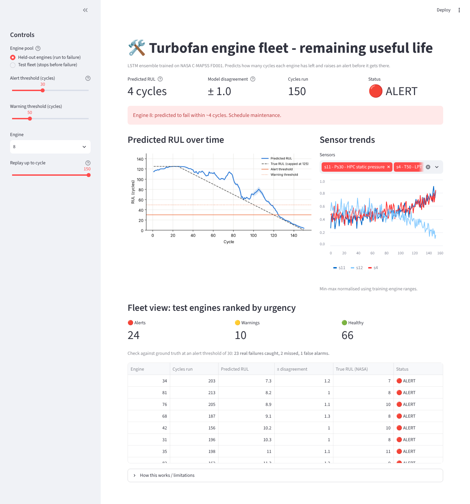
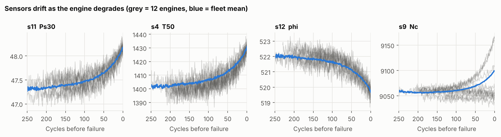
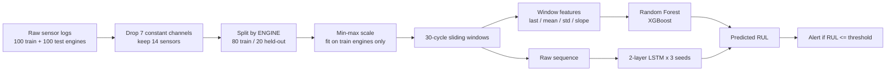
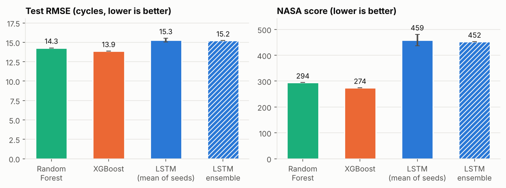
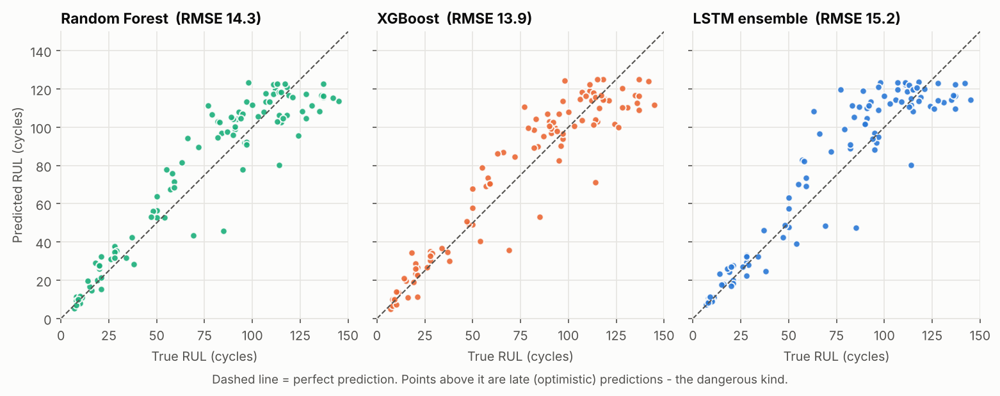
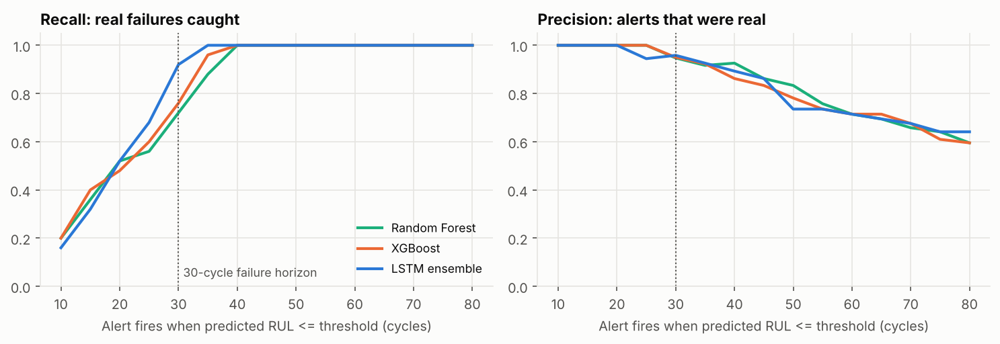
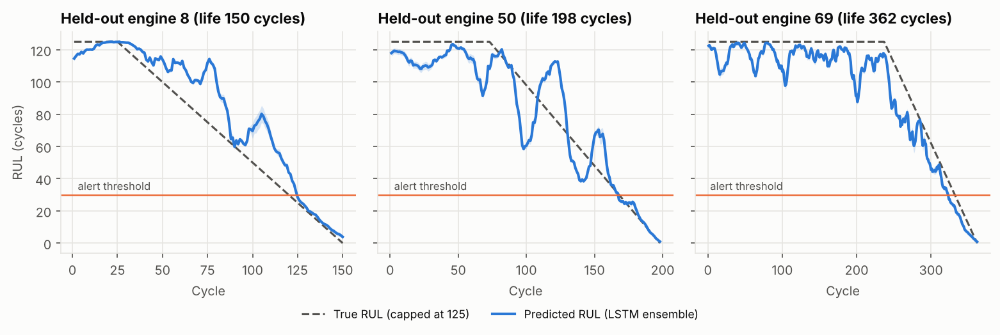

# Engine Predictive Maintenance: Remaining Useful Life (RUL) on NASA C-MAPSS

> **Predict how many operating cycles a turbofan engine has left, and raise an alert before it gets there**, so maintenance can be planned instead of reacting to unplanned downtime.

Tree-based baselines (Random Forest, XGBoost) vs. an LSTM ensemble, evaluated with the standard NASA protocol, plus an interactive **fleet-health dashboard** (Streamlit) with a tunable alert threshold.



## Why this problem

Unplanned engine failure is far more expensive than a planned repair, but replacing parts too early wastes useful life. A good RUL model lets a fleet operator service the *right* engine at the *right* time. Two things make this problem interesting from an engineering view:

1. **Errors are asymmetric.** Predicting failure *late* (engine has less life than you think) is much worse than predicting it early. The NASA score used here encodes this.
2. **A prediction is only useful if it triggers the right action.** So the project goes beyond RMSE and evaluates the *alert*: how many real failures are caught, and how many false alarms it costs.

## Data

[NASA C-MAPSS](https://www.nasa.gov/intelligent-systems-division/discovery-and-systems-health/pcoe/pcoe-data-set-repository/) (Commercial Modular Aero-Propulsion System Simulation), subset **FD001**: 100 training engines run to failure, 100 test engines whose data stops before failure (true RUL supplied separately), 21 sensors, one operating condition, one fault mode (high-pressure-compressor degradation). Public NASA data; the three FD001 files are included in `data/CMAPSS/` (5 MB), and `scripts/download_data.py` restores them (or fetches FD002-FD004).



## Approach



Key design decisions (and why):

| Decision | Reason |
|---|---|
| **RUL capped at 125 cycles** (piecewise-linear target) | A brand-new engine and one with 200 cycles left look identical in the sensors; forcing the model to tell them apart only adds noise. Standard practice on C-MAPSS. |
| **Split by engine, never by row** | Rows from the same engine are highly correlated; a row-level split leaks the answer. 20 engines are held out for early stopping and for the dashboard's "unseen engine" demo. |
| **Scaler fitted on training engines only** | Prevents leakage of test statistics. |
| **Windows ending at *every* cycle** (left-padded) | Gives a prediction at every point of an engine's life, which the dashboard replays like live monitoring. |
| **Hand-crafted window features for trees** (last value, mean, std, linear slope per sensor) | Trees cannot read a time series; the slope is the degradation *rate*. |
| **LSTM ensemble of 3 seeds** | Single-seed variance is visible (see below); the ensemble spread doubles as an uncertainty estimate in the dashboard. |
| **Test scored on each engine's last window** | The official NASA protocol, using the provided true RUL file. |

## Results

Test set = 100 engines, last observed cycle, true (uncapped) RUL from `RUL_FD001.txt`. Lower is better for RMSE / MAE / NASA score.

| Model | RMSE | RMSE (true RUL ≤ 30) | MAE | NASA score | R² | Recall @30 | Precision @30 | Ranking AP | Ranking AUC |
|---|---|---|---|---|---|---|---|---|---|
| Random Forest | 14.29 | 5.62 | 11.32 | 294 | 0.882 | 0.72 | 0.95 | 0.976 | 0.993 |
| XGBoost | **13.86** | 5.63 | **10.65** | **274** | **0.889** | 0.76 | 0.95 | **0.988** | **0.996** |
| LSTM ensemble | 15.22 | **3.99** | 11.32 | 452 | 0.866 | **0.92** | 0.96 | 0.983 | 0.995 |
| LSTM single seed (mean ± std, n=3) | 15.29 ± 0.24 | - | - | 459 ± 22 | - | - | - | - | - |

*Recall/Precision @30: the alert fires when predicted RUL ≤ 30, and "positive" means the engine really fails within 30 cycles (25 of the 100 test engines). Ranking AP/AUC measure how well predicted RUL separates those 25 engines from the rest, independent of any threshold.*




### What the numbers actually say

- **On overall error, the simple models win.** XGBoost on four hand-crafted features per sensor has the lowest RMSE and NASA score. A reasonable explanation is that FD001 is small (80 training engines) and its degradation is smooth, so a good summary feature (the slope) captures most of the signal; I did not run an ablation to prove this.
- **The differences are not statistically clear.** Paired bootstrap over the 100 test engines (5,000 resamples):
  - LSTM ensemble − XGBoost RMSE = **+1.33** cycles, 95% CI **[−0.30, +3.06]**
  - Random Forest − XGBoost = +0.42, 95% CI [−0.66, +1.50]

  All intervals include 0. With 100 test engines I would not claim that any model is better overall.
- **The LSTM is most accurate when it matters.** For the 25 engines within 30 cycles of failure, its RMSE is **3.99** vs ~5.6 for the trees. Its overall RMSE is worse because it is noisier early in an engine's life (see trajectories below), where being off by 20 cycles is harmless.
- **Beware of comparing alert recall directly.** At the same threshold (30), the LSTM catches 23/25 real failures vs 19/25 for XGBoost, but this is largely because the LSTM predicts lower RUL values on average. The threshold-free ranking metrics (AP 0.983 vs 0.988) show the models rank engines almost identically. In production, each model's threshold should be calibrated on validation data.



With a strict threshold (≤ 20 cycles) every alert is real (precision 1.0) but only about half of the true failures are caught; widening it to 35-40 cycles catches all 25 at the cost of a few false alarms, and by 70-80 cycles precision has dropped to roughly 0.65. That is the classic **false-alarm vs missed-failure trade-off**, and the dashboard slider lets you explore it.

### Example trajectories on held-out engines



Predictions are good in the final stretch but can dip mid-life (a false-alarm risk). A production system would require the alert to persist for several consecutive cycles before firing; see *Improvements*.

## Dashboard

```bash
streamlit run app/streamlit_app.py
```

- Pick an engine from the **held-out** pool (full run-to-failure, so the true RUL curve is drawn) or from the **test fleet**.
- **Replay** slider: scrub back in time and see what the model knew at that cycle.
- Tunable **alert / warning thresholds**; traffic-light status; ± ensemble disagreement as a confidence hint.
- **Fleet view**: all 100 test engines ranked by urgency, with a live count of real failures caught / missed / false alarms at the chosen threshold.

## Quickstart

```bash
git clone https://github.com/shubham-patel-7/engine-rul-predictive-maintenance.git
cd engine-rul-predictive-maintenance
python -m venv .venv && source .venv/bin/activate      # Windows: .venv\Scripts\activate
pip install -r requirements.txt && pip install -e .

python -m rul.train --seeds 0 1 2    # trains RF, XGBoost, 3x LSTM (~6-7 min on a 2-core CPU)
python -m rul.report                 # regenerates figures + results table
pytest -q                            # 12 tests
streamlit run app/streamlit_app.py   # dashboard
```

Trained LSTM weights and XGBoost are committed in `models/`, so the dashboard runs right after install. `make all` runs everything.

## Repository layout

```
src/rul/
  config.py      constants: RUL cap, window, sensor list, paths
  data.py        loading, RUL labels, by-engine split, JSON-serialisable scaler, windowing
  features.py    last / mean / std / slope window features
  models.py      LSTM regressor + training loop (early stopping), RF / XGBoost factories
  metrics.py     RMSE, MAE, R², asymmetric NASA score, alert precision/recall
  train.py       end-to-end training + evaluation -> models/, results/
  inference.py   RULPredictor (LSTM ensemble) + traffic-light alert logic
  report.py      figures, results table, bootstrap CIs
app/streamlit_app.py   fleet dashboard
tests/                 data integrity, no-leakage checks, metric correctness, headless dashboard run
scripts/download_data.py
results/               metrics.json, predictions_test.csv, results_table.md, figures/
```

## Testing

12 tests cover: dataset shape; RUL labels (cap, reaches 0); **engine-level split has no overlap**; scaler fitted on train only and JSON round-trip; window shape / padding / **no look-ahead**; slope feature correctness; NASA-score asymmetry; alert confusion counts; saved-model inference; and the dashboard executing headlessly.

## Limitations

- **Simulated data, one operating condition, one fault mode.** FD002/FD004 (six operating conditions) and multi-fault settings are harder; the pipeline loads them but I have not evaluated them.
- **Small test set** (100 engines, 25 near failure): metrics have wide uncertainty (see CIs).
- **Models are trained on 80 of the 100 training engines** so that 20 stay held out for early stopping and honest demos. Retraining on all 100 would likely help a little.
- LSTM hyper-parameters (hidden size 64, window 30) were chosen by hand and not tuned.
- Real fleets need per-engine calibration, missing-sensor handling, drift monitoring and a maintenance-cost model to set the alert threshold.

## Improvements I would make next

1. Require N consecutive cycles below threshold before alerting (suppresses mid-life dips).
2. Choose the alert threshold from a cost model (cost of a missed failure vs a false alarm) on validation data.
3. Hyper-parameter search with by-engine cross-validation; try a 1D-CNN/Transformer and attention over time.
4. Extend to FD002-FD004 and report per-subset results.
5. Prediction intervals via quantile regression or conformal prediction instead of ensemble spread.

## References

- A. Saxena, K. Goebel, D. Simon, N. Eklund, *Damage Propagation Modeling for Aircraft Engine Run-to-Failure Simulation*, PHM 2008.
- NASA Prognostics Center of Excellence data set repository (C-MAPSS).

## License

MIT (see `LICENSE`). Dataset © NASA, public domain.


---

## Demo runs and result analysis

Three runs of the dashboard logic on held-out engines (`python scripts/demo_runs.py`; raw numbers in `results/demo_runs.json`). Each engine is replayed cycle by cycle using only the data available at that cycle, exactly like the dashboard's replay slider. I picked the shortest-, median- and longest-lived engine among the 20 held-out engines so the three runs cover different degradation speeds.

| Demo run | Engine | Life (cycles) | WARNING (pred <= 50) fires at | ALERT (pred <= 30) fires at | ALERT lead time (cycles before failure) | False-alert cycles | Missed-alert cycles | Error at last cycle | MAE, last 30 cycles |
|---|---|---|---|---|---|---|---|---|---|
| Shortest-lived | 8 | 150 | cycle 118 | cycle 125 | 25 | 0 | 5 | +3.9 | 3.7 |
| Median-lived | 50 | 198 | cycle 136 | cycle 168 | 30 | 0 | 0 | +1.0 | 1.6 |
| Longest-lived | 69 | 362 | cycle 298 | cycle 323 | 39 | 9 | 0 | +0.8 | 5.6 |

*False-alert cycle: ALERT is on while more than 30 cycles really remain. Missed-alert cycle: ALERT is off although 30 or fewer remain. Error = predicted minus true RUL, so positive means the model is optimistic.*

**What the three runs show**

1. **The alert logic works as intended on all three engines.** Each alert switched on once and stayed on (no flapping), and each engine got between 25 and 39 cycles of warning. Engine 50 is the textbook case: the alert fired exactly 30 cycles before failure with a final-cycle error of +1.0.
2. **The timing error depends on how fast the engine degrades.** The shortest-lived engine was alerted 5 cycles *late* (25 cycles left instead of 30), and the longest-lived one 9 cycles *early*. This is consistent with a model that pulls its estimate toward the typical engine life; with only three engines I cannot prove that, but it is a testable hypothesis (plot error against engine life on all 100 test engines).
3. **Late is the more costly direction.** The late alert on engine 8 (and its +3.9 optimistic final error) is the failure mode that matters in maintenance; the early alert on engine 69 only costs an earlier inspection. This is why the project reports the asymmetric NASA score and recall at the alert threshold, not just RMSE.
4. **The ensemble spread understates the real error.** Averaged over the healthy phase, the three seeds disagree by only 0.6 to 1.7 cycles while the actual error is 3.5 to 11.7 cycles. The seeds share training data and architecture, so they tend to make the same mistake; the "±" shown in the dashboard is a weak confidence signal, not a prediction interval (see "Improvements", item 5).

**Caveats.** Three engines illustrate behaviour; they are not a statistical result (the 100-engine test results above are). These 20 engines were also used for early stopping, so they are slightly more favourable than truly unseen engines. Healthy-phase errors (true RUL at the 125 cap) are large in relative terms but do not matter for alerts, which only look at the last 30 to 50 cycles.
